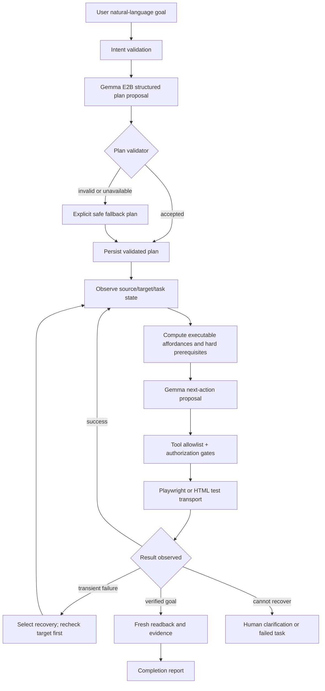
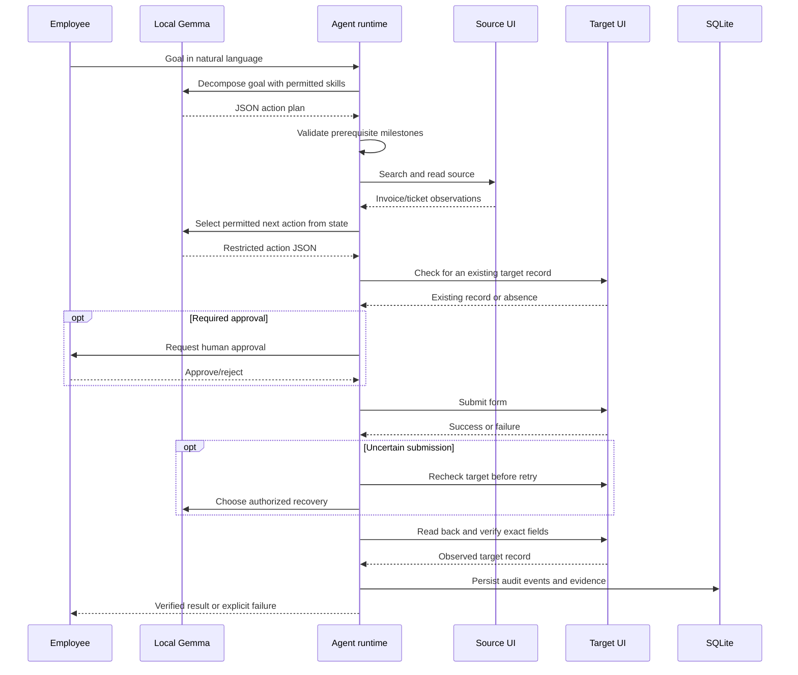

# CentrAlign AI v6 — Planning, Replanning and Failure Recovery

## 1. Objective and scope

Implement the three previously partial internship expectations within two authentic local enterprise workflows:

1. **Decomposition:** turn a goal into an executable list of skills rather than require a user-authored click sequence.
2. **Observation-conditioned decisions:** choose the next action after inspecting fresh source/target state.
3. **Alternative recovery:** use more than a blind retry when search, browsing, submission or verification behaves unexpectedly.

The supported environment remains the local invoice inbox + accounts payable ledger, and support ticket inbox + case system. The applications, forms, persisted writes, approvals and readback are real localhost operations, but enterprise documents and customers are synthetic.

## 2. High-level design (HLD)

### Architectural decisions

- **LLM plans; code authorizes.** Gemma proposes steps and choices; the runtime enforces identity, permissions, causal prerequisites, retries and completion proofs.
- **No arbitrary tool names.** Every proposal uses an enum backed by known local tools. JSON output is checked again in Python.
- **State observation before irreversible actions.** Writes require a source match, target lookup and, where applicable, manager approval.
- **Idempotency by readback.** When a write response is ambiguous, check the target application before another submit.
- **Transparent degradation.** A rejected/unavailable model plan is reported as `validated_fallback`. It is never misreported as an LLM-authored plan.

## 3. Low-level design (LLD)

| File / component | Contract |
|---|---|
| `app/agent/gemma.py` | Local-only Ollama `/api/chat`, structured JSON for `plan` and `action`, no external URI support |
| `app/agent/planner_v6.py` | `canonical_steps`, `validate_plan`, `build_plan`, `ObservationPlanner` |
| `app/agent/reactive.py` | Two workflow executors, observed `TaskState`, dynamic action affordances, failure recovery and fresh verification |
| `app/agent/policy.py` | Restrict Gemma tool choices and classification, apply transparent fallback |
| `app/agent/browser_v4.py` | Live Chromium, semantic UI actions, visible mouse, DOM observations, video and trace |
| `app/agent/browser.py` | HTML-over-HTTP adapter for CI, real local forms, target readback and form refresh |
| `app/db.py` | SQLite source and target data, task state, human approvals and audit logs |
| `app/main.py` | Local dashboard, sandbox applications, evidence and one-shot failure injection controls |

### Structured plan contract

Gemma receives the original request, parsed goal, descriptions of allowed skills, and the list of non-negotiable milestones. It returns `steps: string[]` and `reason: string`.

`validate_plan` rejects: unknown tools, repetition, missing milestones, wrong dependency order, a write in a read-only check, finishing before verification, or optional refreshes placed at unsafe points. A validated plan can include optional search refresh, target recheck and form refresh.

**Important:** Only *supported* skill steps may be included. The model cannot invent a new website connector or enterprise workflow without implementation and testing.

### State-dependent action selection

A separate goal-state planner calculates a **safe stage** using `selected`, `source`, extracted `facts`, `lookup_done`, `entry_id`, approval state, `write_attempts` and `verified`. `adaptive_step` exposes bounded alternatives relevant to that exact stage:

- `read_source`: read the selected source, or refresh and reselect it.
- `write`: submit, recheck the target, or reopen the form; no write action exists without prior approval checking.
- `verify`: read the saved record, or first recheck its current existence.

`ObservationPlanner.choose` supplies the fresh observation, initial plan and previous recovery counts to Gemma. A returned tool must be in the **current** allowlist. Each optional action is capped once per stage to prevent non-progress loops, and the complete run has a 35-iteration bound.

### Recovery algorithms

**Source search:** filtered search → if empty or failed, search full local inbox and filter identity again → ask for human clarification if missing. The broader search never permits selecting a different vendor or ticket number.

**Document page:** transient source read failure → choose `refresh_search` or `ask_human` → refresh inbox and retry document once. Never execute instructions embedded in the source document.

**Form submission:** `RetryableToolError` → check target readback **unconditionally** → if record exists, proceed to verification; if absent, request a safe recovery choice (`reobserve_target`, `refresh_form_and_retry`, `ask_human`) → retry no more than three times.

**Verification:** mismatch → one new independent readback → persist result or fail/escalate without claiming completion or overwriting an existing record.

## 4. Invoice and ticket sequence

## 5. Evaluation and evidence

Tests exercise model-generated valid and invalid plans, rejection of unsafe tools, forced Gemma selection of an alternative pre-write action, one-shot accounting and helpdesk 503 failures, bounded recovery, human approvals, invoice and ticket readback and baseline regression behavior.

**Verification limits:** Test Gemma responses are produced by a **simulated local Ollama protocol server**. The execution targets *real local company HTTP forms and SQLite*; it does not establish accuracy of the actual Gemma weights. Chromium component tests may skip when the browser is unavailable. A complete real Gemma + visible Playwright task still requires a successful run on your Mac.

## 6. Future extensions

The architecture is intentionally narrow. To support unfamiliar tasks, add company tools with typed schemas, explicit security scopes, validation contracts and deterministic completion predicates; only then allow Gemma to plan with those skills. Broader UI changes need evaluation datasets, permission-aware retries, and a human review mechanism for ambiguous writes.
